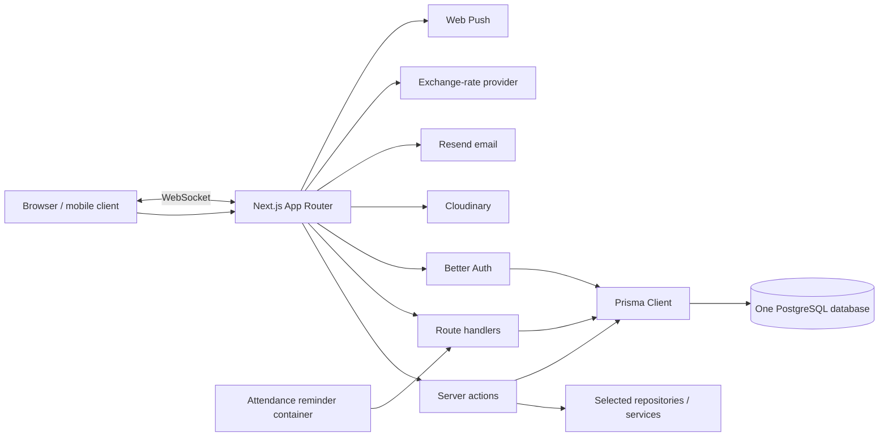

# Existing CRM System Analysis

## Scope

Assessment from checked-in app, schema/migrations, auth/permission code, actions, repositories, services, tests, Docker/CI and docs. Local environment files were excluded. This is source review only; no production DB, cloud account, runtime traffic, load test or penetration test was inspected.

## Summary

This is a feature-rich **Next.js 16.4.6 App Router application** using React 19, TypeScript, Better Auth 1.6.25, Prisma 7.9 and PostgreSQL. Most backend logic lives in Next server actions and route handlers; a partial repository/service layer exists. A single Prisma schema/database serves identity, organizations, CRM, projects, collaboration, finance, HR, attendance and payroll. No NestJS backend, API gateway, broker, Redis or independently deployed business service was found.

Existing capabilities include organization/team administration, tenant-aware permissions and custom role templates, customer/contact/catalog, proposals/invoices, project/task/chat, notifications, finance, attendance, leave/holidays and payroll. Better Auth sessions are stored through Prisma. CI builds one standalone Next image and a separate attendance scheduler image, deploying through GitHub Actions, GHCR, SSH and Docker Compose.

## Existing architecture

## Inventory

| Area | Observed |
|---|---|
| UI | Next App Router pages, server/client components, `app/` and `components/`; TanStack Table/Query, React Hook Form, Zod installed. |
| Backend | Next server actions/routes, `proxy.ts`, custom Node server; no NestJS service. |
| Data | PostgreSQL, one Prisma schema and long migration history. Central pg adapter in `lib/prisma.ts`. |
| Auth | Better Auth email/password, verification/reset, OAuth providers, admin and organization plugins, Expo, `nextCookies`; organization membership/team and active org session. |
| Authorization | Platform `SUPER_ADMIN`/`ADMIN`/`STAFF`, org `owner`/`admin`/`member`, dynamic org roles and HR/Finance/Sales Executive templates; route, resource and record-scope checks coexist. |
| Tenancy | Organization-aware membership and some tenant-scoped models/queries; tenant ID is nullable or absent on many business/employee entities. Isolation is app-enforced and incomplete as a universal schema invariant. |
| Integrations | Cloudinary, Resend, exchange rates, Nominatim-compatible search, Web Push, Chromium/Puppeteer PDF, custom WebSocket. |
| Jobs/realtime | Separate attendance scheduler calls cron routes; WebSocket logic runs in `server.mjs`; no durable broker/general worker. |
| Delivery | GitHub Actions, GHCR, Docker multi-stage non-root runtime, SSH/Compose. No Kubernetes/IaC manifests found. |
| Tests | tsx unit/model tests, Playwright E2E, Selenium artifacts. No tests run for this documentation task. |

## Domain model map

- Identity/org: `User`, `Session`, `Account`, `Verification`, `Organization`, `Member`, `Invitation`, `OrganizationRole`, `Team`, `TeamMember`.
- CRM: `Customer`, `CustomerContact`, `Service*`, `Product`, `Proposal*`, `Company`, `CompanyBankAccount`, `TariffGrid*`, `Invoice*`, `Expense*`, finance accounts/categories, exchange-rate cache.
- Work/collaboration: `Project`, `ProjectTask*`, `ProjectActivity`, `Conversation*`, `ChatMessage*`, comments, attachments, time entries.
- People: employee status history, attendance records/settings/audits/reminders, leave, holidays, salary structures/slips/adjustments/PINs.
- Platform: notifications, push subscriptions, issue reports, measurement units, countries/states.

## Competitor reference capability comparison

The supplied sidebar screenshots are a **market benchmark**, not evidence that these features exist here and not a directive to clone every item. I compared them with current navigation/routes and schema.

| Competitor capability | Current CRM evidence | Assessment |
|---|---|---|
| Leads | No first-class Lead model/route; telecalling is a prototype, not proof of lead lifecycle. | Gap; define qualification and conversion first. |
| Contacts | `CustomerContact` and primary contact fields exist. | Partial: customer-bound, not a prospect/contact directory. |
| Accounts | Company profile and customer company name exist; no customer-account hierarchy found. | Gap/partial; distinguish tenant company settings from buyer accounts. |
| Deals | Proposals and Projects exist; no Opportunity/Deal pipeline model found. | Gap; proposal is not a deal-stage model. |
| Forecasts | Reports exist, based largely on proposals/invoices; no pipeline probability forecasting found. | Gap. |
| Documents | Proposal/invoice PDFs, uploads and Cloudinary exist. | Partial: no general account-linked document library found. |
| Campaigns | No marketing campaign domain found. | Gap; validate product scope. |
| Tasks | Project tasks and workflows exist. | Present in project context; generic CRM follow-up tasks may need lead/contact/deal links. |
| Meetings and Calls | No first-class meeting/call log identified. | Gap; decide calendar/telephony integrations and activity capture. |
| Products and Price Books | Products, Services/Packages, Tariffs and proposal pricing exist. | Substantial equivalent; confirm tariff grids meet price-book use cases. |
| Quotes | Proposal pricing, workflow, acceptance and public review exist. | Strong adjacent equivalent; preserve proposal version/immutability rules. |
| Sales Orders | Invoices exist; no order/fulfilment lifecycle found. | Gap; define accepted proposal to order transition. |
| Purchase Orders and Vendors | Expenses/accounts exist; no procurement/vendor lifecycle found. | Gap; distinct from sales invoicing. |
| Invoices | Invoice, line items, payments and activity models/routes exist. | Present. |
| Cases and Solutions | Issue reports cover internal issues/suggestions; no customer support cases/knowledge base found. | Gap; internal issues are not support tickets. |
| SalesInbox, Social, Visits | Transactional email exists; no synchronized sales inbox/social/visit domain found. | Gap; provider, consent, synchronization and activity-history decisions needed. |
| Services and Projects | Service catalog and project/task management exist. | Present; verify links to customer/deal lifecycle. |

These are candidate product gaps, not automatic priorities. Validate customer demand, market, integrations and intended CRM type before adding capabilities.

## Strengths and reusable foundations

- Mature workflows and migration history; preserve behavior rather than rewrite.
- Better Auth organization plugin, active organization context, membership checks, teams, custom permissions and role templates.
- Zod validation, action response/error helpers, selected repositories/services, activity/history models and domain tests.
- Tenant-aware filtering already exists in important flows including products, proposals, org membership and measurement units.
- Soft-delete conventions for customers/invoices; proposal/invoice activity histories; transaction use in select multi-table workflows.
- Container build, non-root runtime, build secrets, deployment automation and validated environment config.

## Gaps and risks

1. **Tenant isolation is partial.** `organizationId` exists on Customer, Service, Product, Proposal, Company, Invoice, AttendanceSettings and MeasurementUnit; several are nullable. Project, Expense and workforce data do not consistently establish tenant ownership. Correctness depends on every query being scoped. Audit before external multi-tenant SaaS use.
2. **Role scopes overlap.** Platform roles, organization roles, business templates, HR department checks and record ownership checks coexist. Define precedence and keep server action/resource checks authoritative.
3. **Layer boundaries vary.** Some actions perform orchestration and raw Prisma operations; repository/service extraction is incomplete. Large salary/invoice/project workflows are candidates for modularization.
4. **Cross-domain coupling is high.** Proposals/invoices depend on customers, catalogs, company, payments and users; projects/tasks/chat and payroll/attendance reference users. Early service splitting introduces distributed consistency and duplicated reference data.
5. **Background/realtime durability is limited.** Cron routes and in-process WebSockets do not provide durable retries, DLQ, multi-instance fanout or job ownership by themselves.
6. **Operations need confirmation.** No broker, Redis, standard gateway, tracing/metrics stack, IaC or K8s was found. Live TLS/proxy/rate-limit/backup/restore controls were not inspected.
7. **Tenant lifecycle needs policy.** Organization creation is platform-admin-gated; signup requires bootstrap signature or invitation. Clarify onboarding, suspension, export, retention and deletion; some organization FKs cascade.
8. **External provider reliability.** Email, storage, FX, geosearch and PDF are called from app workflows; define timeouts, retries and idempotency as usage grows.

## Extraction guidance

First establish tenant invariants and application-service boundaries in the current deployable app. Keep transaction-coupled customer/catalog/proposal/invoice together. Potential later extractions: notification/jobs, reporting projections, Work, People, then identity only if independent lifecycle/SSO is justified. Subscription Billing is not evidenced by existing customer invoicing and would be a new product capability.
