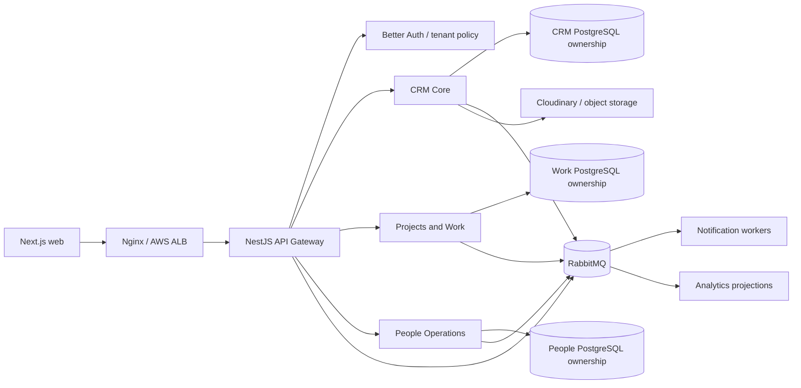

# Proposed Target Architecture

## Recommendation

Adopt a **modular monolith first**, then extract services only when a bounded context has demonstrated scale, release, security or ownership needs. Keep the existing Next.js app and functionality while creating NestJS boundaries incrementally. The target below is not a day-one rewrite.

Use **PostgreSQL**: it is already in use and suits relational workflows, transactions and decimal money. Use **RabbitMQ** for initial async work queues/events; Kafka is justified when high-volume replayable streams and many independent consumers become actual requirements. Do not add Redis until cache, distributed rate-limit, session, or coordination needs are measured. RabbitMQ already handles durable jobs.

If the repo becomes a multi-app Next/Nest workspace, prefer **Nx** for project graph, Nest generators and affected builds. Turborepo is lighter for task orchestration. Do not migrate solely to adopt a tool; first settle module boundaries. Continue using pnpm.

## Target logical diagram

Initially modules can share a process/database while enforcing module API and schema ownership; future services may not query one another's tables.

## Boundaries

1. **Identity and tenant access:** keep Better Auth and its organization plugin; tenant lifecycle stays an application module until it warrants independent APIs.
2. **CRM Core:** customers/contacts, catalog, proposals, invoices, company/account, payments and finance. Keep together due to transactions and snapshots.
3. **Work Management:** projects, tasks, activity and project collaboration; later service if realtime/scale/ownership makes it useful.
4. **People Operations:** employment, attendance, leave, holidays and payroll; separate logical boundary because of sensitive data and different access policy.
5. **Notifications/Jobs:** cross-cutting delivery is a good future worker/service boundary after outbox and broker.
6. **Reporting:** start as in-app reads; create event-fed projection when report load affects writes.
7. **Files:** keep Cloudinary now; centralize authorization/metadata. Dedicated service only if storage policy or volume requires it.
8. **Billing:** no SaaS subscription bounded context found; add only if CRM subscription plans are in product scope.

## Competitor benchmark implications

The supplied competitor menu is a capability checklist, not a required clone. Keep Customers/CustomerContacts, Proposals, Invoices, Products/Services/Tariffs, Projects and Tasks as the foundation. The largest product-model gaps are first-class Leads, Accounts, Deals/opportunity pipeline, Forecasts, generic Activities (meetings/calls), Sales Orders, procurement/vendors, customer-support Cases/Solutions, Campaigns and connected sales communications. Validate demand before prioritizing. Initially place approved capabilities inside CRM Core or Work; do not create a microservice per navigation item. Model lead conversion, deal lifecycle and quote/order transitions explicitly instead of treating menu labels as service boundaries.

## Infrastructure responsibilities

| Component | Responsibility |
|---|---|
| Load balancer (ALB) | Distributes requests over healthy instances; may terminate TLS. |
| Nginx reverse proxy | Optional edge routing, request limits, TLS forwarding and coarse IP limits. Avoid if ALB covers the need. It does not authorize CRM records. |
| NestJS API Gateway | Application auth verification, tenant context, validation, coarse permissions, routing/orchestration and response errors. Avoid domain ownership here. |
| Service discovery | Compose DNS locally or Kubernetes Services in a cluster. No Eureka/Consul unless orchestration cannot meet needs. |
| RabbitMQ | Durable async delivery, routing, retry and dead-letter queues. Not a synchronous gateway or DB. |
| Redis (optional) | Ephemeral cache, distributed rate limits, coordination; not source of truth by default. |
| Kubernetes (later) | Scheduling, health restart, discovery, scaling and rollouts when Compose operations no longer suffice. |

## Communication and AWS path

Use REST for immediate user operations and RabbitMQ for side effects/projections. gRPC only when measured internal call requirements justify it. Later AWS layout: ALB to gateway/app tasks, private PostgreSQL, managed RabbitMQ/Amazon MQ, secrets manager, logs/metrics and object storage. Introduce K8s only when service/operations complexity justifies it. Keep a single deployable CRM until tenant security and module boundaries are proven.
