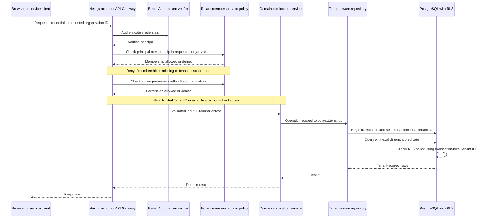

# Multi-Tenant Design

## Recommendation and current state

Use shared PostgreSQL database/shared schema with **non-null `tenant_id` (organization ID) on every tenant-owned business row**, tenant-scoped composite constraints, application predicates and PostgreSQL Row-Level Security (RLS) as defense in depth. This matches the current PostgreSQL/Prisma baseline and keeps operations manageable. Keep a path to dedicated DBs for regulated/high-volume tenants. Schema-per-tenant multiplies migrations; database-per-tenant is appropriate only for explicit compliance, residency or noisy-neighbor needs.

The current app is organization-aware but not universally isolated: org ID is nullable on several core models and absent on others. Employee/payroll and customer CRM semantics also need a clear owner. Never claim current multi-tenancy is complete without a model/query audit.

## Tenant identification and request context

1. Authenticate Better Auth session or verify a short-lived service token.
2. Treat tenant ID from host/path/body as a requested context only; validate current membership or explicit platform scope.
3. Resolve the canonical tenant ID server-side and compare requested tenant to authorized tenant.
4. Attach immutable `TenantContext { tenantId, userId, actorType, roles, correlationId }`.
5. Require context for tenant-owned repository operations; never accept public `X-Tenant-*` as authority.

A subdomain can select a candidate tenant; it does not establish access. For users in multiple orgs, active organization selection changes session context after membership validation.

## Isolation controls

- Make tenant ID non-null on all tenant-owned roots and children. Decide whether workforce data is per-tenant or platform-wide.
- Tenant-scope natural unique keys (slug, customer numbering) and use composite FKs `(tenant_id, parent_id)` so a child cannot point across tenants.
- Require tenant ID in repository methods; filter every read/update/delete. Foreign-tenant object IDs return not-found.
- Use transaction-local PostgreSQL `set_config('app.tenant_id', ...)` and RLS policies. Runtime app DB role must not have `BYPASSRLS`; ensure pooled transactions set context safely and missing context denies access.
- Scope membership, roles, teams, searches, reports, exports, upload/download and websocket access.
- Keep public proposal capability links unguessable, scoped to a single proposal/version and revocable where policy permits.

## Provisioning and lifecycle

Create org, owner membership, default policy/config and outbox event atomically where feasible. External provisioning is idempotent and asynchronous. Suspension denies data operations while retaining data/audit. Export, retention, legal hold and deletion require explicit policy; stage tombstone and purge after retention. Review current cascade deletes before offering tenant deletion.

## Isolation flow

The browser-provided organization ID selects which membership to check; it is not copied into trusted context until the server has authenticated the principal and confirmed membership and permission. The repository still includes an explicit tenant predicate, while RLS independently restricts rows using transaction-local context. If either check fails, stop before calling the domain service or querying tenant data. For platform-wide administration, use a separate, explicitly authorized and audited path rather than bypassing tenant checks implicitly.

## Verification

Test cross-tenant list/detail/update/delete, nested records, search, reports, exports, files, realtime and background jobs. Verify absent context is denied by RLS. Logs may include tenant ID but not credentials or sensitive payroll/customer payloads.
