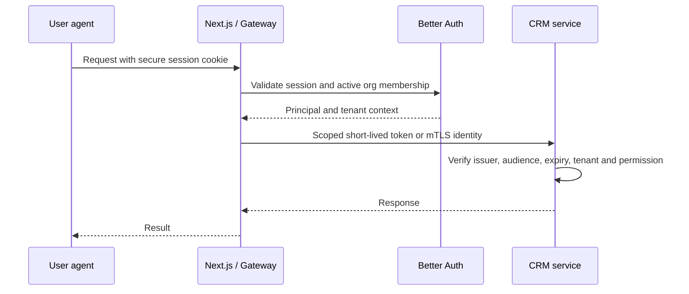

# Authentication and Authorization

## Better Auth fit

Better Auth 1.6.25 is already integrated with Prisma/PostgreSQL, organization/admin/Expo plugins, email/password, verification/reset, OAuth providers, invitations, active organization/team state and dynamic access control. Keep it as identity/session provider unless independent SSO or lifecycle needs arise. Do not start by replacing auth.

Better Auth organization roles are suitable for org administration; custom access control supports domain permissions and tenant roles. Existing code has `owner/admin/member` plus HR, Finance and Sales Executive templates. Preserve the separation. Check documentation and API behavior against the installed release before configuration changes; current docs can describe newer features.

## Role layers

| Scope | Examples | Purpose |
|---|---|---|
| Platform | `SUPER_ADMIN`, existing `ADMIN` semantics to verify | Platform tenant operations; tightly held and audited. |
| Organization | `owner`, `admin`, `member` | Organization settings, membership, teams, invitations. |
| Business | HR, Finance, Sales Executive, future Sales Manager | Domain operations within a tenant. |
| Record scope | own, assigned, team, all | Data visibility/mutation predicates, not a UI-only property. |

Department is context, not an implicit grant. Resolve overlap through an explicit policy matrix; deny by default. Do not convert `User.role` directly into CRM roles.

## Future auth/service flow

For the current single-process app, server actions use Better Auth session APIs and server-side permission checks. For NestJS services, evaluate Better Auth JWT/JWKS for short-lived audience-scoped service tokens; validate signature, issuer, audience, expiry, key ID, subject and tenant. Never forward browser cookies to arbitrary services or trust decoded claims. Service identity and user identity remain distinct. A stale permission in a token needs a bounded lifetime or version/revocation strategy.

## Mandatory authorization sequence

1. Authenticate; verify account/employment active.
2. Resolve tenant membership and tenant lifecycle.
3. Check action permission server-side.
4. Apply record scope and ownership in DB predicates (`tenant_id`, owner/assignee/team, immutable status).
5. Validate server input with Zod and normalize fields.
6. Audit sensitive role/member changes, tenant lifecycle, proposal send/accept, invoice/payment, payroll and platform actions.

UI checks only improve usability. Cron/webhooks use separate rotated credentials/signatures, replay protection and idempotency. OAuth secrets stay server-only; cookie-authenticated mutations retain CSRF/origin protection.

## Session and implementation checks

The current Better Auth config sets 30-day session expiry and one-day update age; reassess for risk and revocation needs. Add MFA/passkeys only with recovery/support flows. A role matrix must cover business role × resource × action × record scope. Verify every server action and route, not just page routes. Test cross-tenant escalation, inactive users, stale membership, org switching, invitation abuse and session revocation. References: [Better Auth Organization](https://better-auth.com/docs/plugins/organization), [Better Auth JWT](https://better-auth.com/docs/plugins/jwt).
