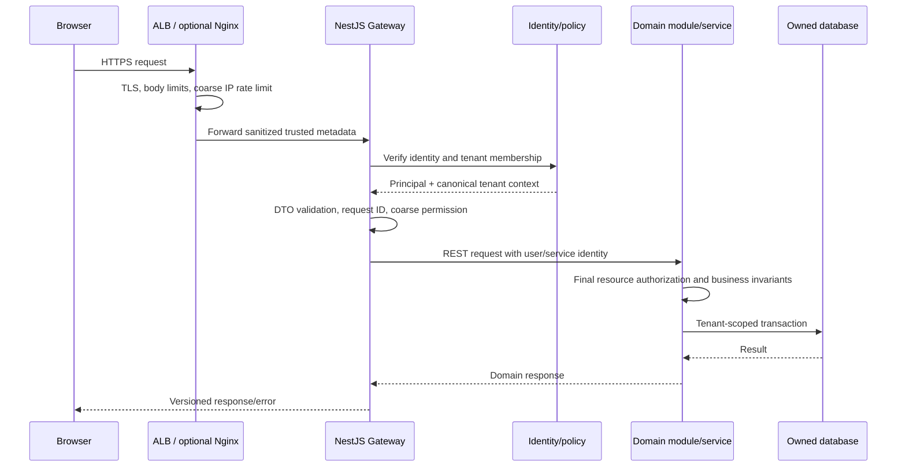

# API Gateway Design

## Current state and target path

There is no NestJS gateway today: Next server actions/routes are the application backend. `proxy.ts` and the custom Node server also participate in request handling/realtime. Introduce NestJS gradually, routing one low-risk endpoint before broad migration.

## Responsibilities

- **ALB/load balancer:** TLS termination if selected and healthy-instance distribution.
- **Nginx (optional):** request sizing/time limits, edge routing and coarse IP throttling. Strip/overwrite untrusted forwarded/tenant/internal identity headers. Avoid duplicating ALB capabilities without reason.
- **NestJS gateway:** authenticate, derive tenant context, validate input, coarse permissions/rate limits, route/orchestrate, normalize errors and add correlation IDs. No domain ownership or unrestricted database access.
- **Domain service:** final resource authorization, business rules, tenant filtering and owned database transaction. Gateway permission is never the only guard.

## API conventions

Use `/api/v1/...`, resource nouns and cursor pagination, e.g. `GET /api/v1/customers?limit=50&cursor=...&sort=-updatedAt`. Allowlist filters/sorts. Standard envelope: `{ data, meta: { cursor, hasMore, requestId } }`; errors `{ error: { code, message, details?, requestId } }`. Do not expose SQL, stack or provider internals. Use idempotency keys for payment/webhook/create operations where retries could duplicate effects.

## Next.js integration

Next remains UI and Server Component layer, using a centralized typed server-side API client. Never bundle gateway secrets or privileged tokens into browser JS. Keep browser mutations behind server actions/same-origin routes for cookie/CSRF policy. Use server reads where practical; TanStack Query for interactive pagination/realtime/cache needs. Public proposal and auth routes receive explicit policies.

## Migration sequence

1. Normalize current action/route contracts and schemas.
2. Define typed API client and error contract.
3. Add Nest gateway app; proxy one read-only route.
4. Move one operation end-to-end and compare auth/data/performance.
5. Add internal identity and outbox before splitting data ownership.
6. Route gradually with rollback switch. Never let gateway become a second cross-domain Prisma client.
