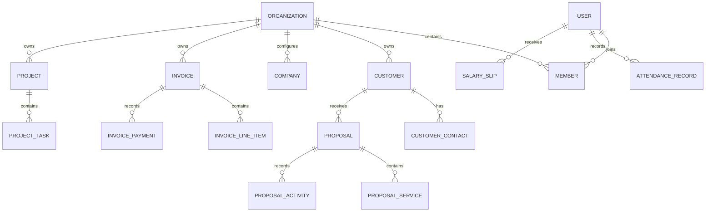

# Database Ownership and Data Design

## Recommendation

PostgreSQL is the pragmatic choice: already used, relational, transactional and suitable for decimal money and uniqueness constraints. Preserve current schema while enforcing logical ownership. At extraction, each service owns schema/migrations; one DB server may host isolated service databases initially. No direct cross-service table access.

## Simplified current model

This is a logical sketch, not the full schema. Organization relations exist for Customer, Service, Product, Proposal, Company, Invoice, AttendanceSettings and MeasurementUnit; some IDs are nullable. Project, Expense and workforce ownership need verification before migration.

## Eventual ownership

| Owner | Candidate tables/aggregates |
|---|---|
| Identity/Tenant | Better Auth auth tables; Organization, Member, Invitation, OrganizationRole, Team, TeamMember. Employee profile ownership is an open decision. |
| CRM Core | Customer/contact, catalog, proposal children/activity, company/bank, invoice children/payment/activity, finance/expense as one initial boundary. |
| Work | Project/task children, conversations/chat, project activity and attachment metadata. Reference users by ID; keep a local member projection. |
| People | Employee lifecycle, attendance, leave, holiday, payroll and sensitive audit, once tenant semantics are decided. |
| Notifications | Delivery attempts/preferences; source outbox remains with publishing owner. |
| Analytics | Rebuildable tenant-scoped read projections only. |

## Constraints, indexes and data rules

- `tenant_id NOT NULL` for tenant-owned rows; lead query indexes with tenant ID, e.g. `(tenant_id, status, created_at)` or `(tenant_id, assigned_to_id, status)` based on measured plans.
- Tenant-local uniqueness and composite foreign keys `(tenant_id, parent_id)` prevent cross-tenant links.
- Preserve helpful current indexes (tenant/status, assigned/deleted, parent/time); avoid duplicate speculative indexes.
- Store money as decimals. Preserve quoted price snapshots. Sent proposals get new versions; paid invoices use adjustments.
- Define soft-delete, retention and purge per entity. Reassess cascade behavior before tenant deletion.

## Migration and consistency

Use expand-and-contract: add tenant columns, backfill through verified mapping, audit orphans/conflicts, add constraints/indexes, enforce writes, then make non-null and remove legacy branches after a compatibility window. Rehearse on sanitized copy and retain rollback/backup plan. Each service owns migrations after extraction.

Within one service use DB transactions. Across services use a persisted Saga only for a real distributed workflow, with idempotent commands, compensations/timeouts and visible state. Transactional outbox atomically records event intent with business change; consumer inbox handles duplicate delivery. Analytics/notifications are eventually consistent; invoice/payment truth remains transactional.

RLS complements app predicates. Runtime role must not bypass policies; transaction-local tenant context must be safe with connection pooling. See [multi-tenant design](./04-multi-tenant-design.md).
