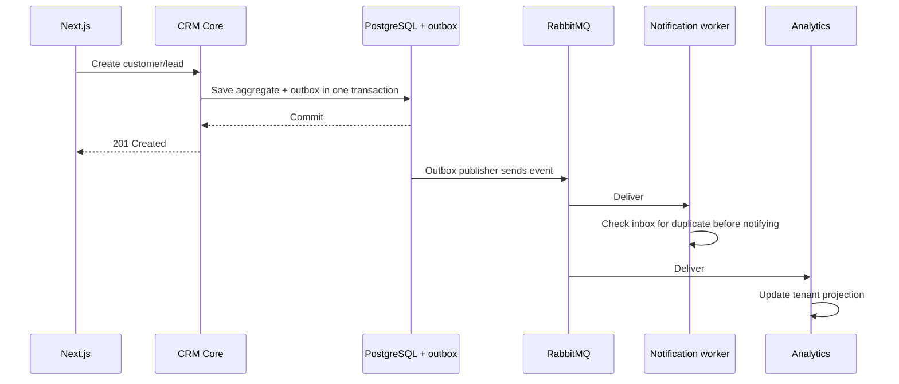

# Event-Driven Communication

## Broker

Recommend **RabbitMQ** for initial jobs and domain events: work queues, routing, retry and dead-lettering fit reminders, notifications and side effects. No broker exists in the current source. Kafka adds operational complexity and is a later choice if high-throughput replayable streams and many independent consumers are needed.

## Example event flow

Customer is the current source model. Add a separate Lead event only if CRM semantics define a separate lead lifecycle; the request's LeadCreated example should not be fabricated from a different business concept.

## Conventions and reliability

- Past-tense facts: `crm.customer.created.v1`, `crm.proposal.sent.v1`, `crm.invoice.payment-recorded.v1`, `people.leave.approved.v1`.
- Envelope: `eventId`, `eventType`, `eventVersion`, `occurredAt`, `tenantId`, `aggregateId`, `correlationId`, `causationId`, actor identity, minimal payload. No secrets or unnecessary PII.
- Add compatible fields within a version; breaking payload changes get a new version with staged consumer migration.
- Transactional outbox in the owning DB; publisher retries until broker confirm. At-least-once delivery is expected.
- Consumer inbox keyed by event ID. Provider calls use idempotency keys where supported.
- Bounded exponential backoff with jitter; classify transient vs permanent failures; send exhausted events to monitored DLQ with safe replay procedure.
- Preserve aggregate ordering only when required; never assume global order.
- Correlation IDs propagate across HTTP/broker; track queue age, retry count, DLQ depth and delivery outcome.

Start with proposal email/notification fan-out or reminder delivery after outbox exists. Publish only after commit from the owning service. Keep aggregate activity history with that domain; central security audit is a separate append-only stream. User-facing create can succeed after local commit while async delivery status remains pending.
