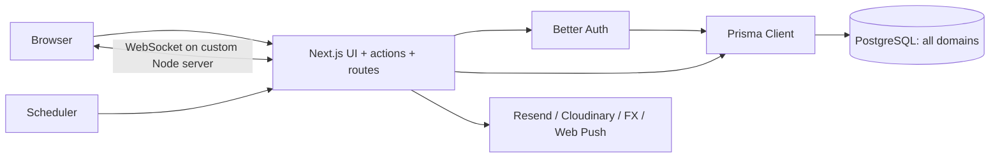
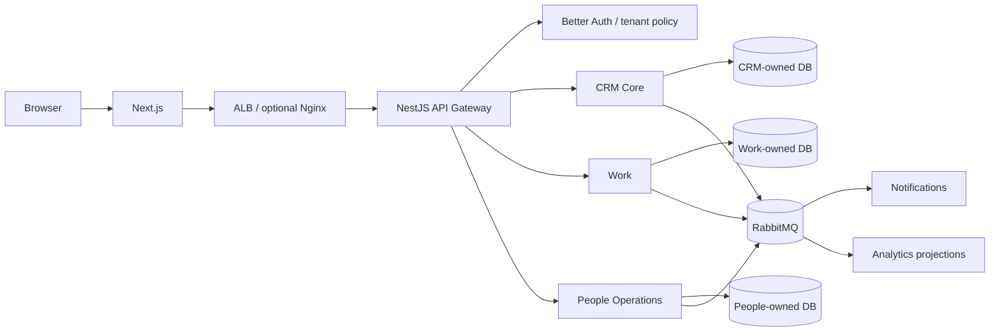
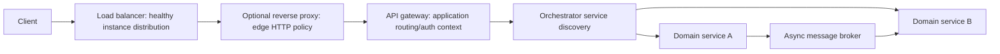
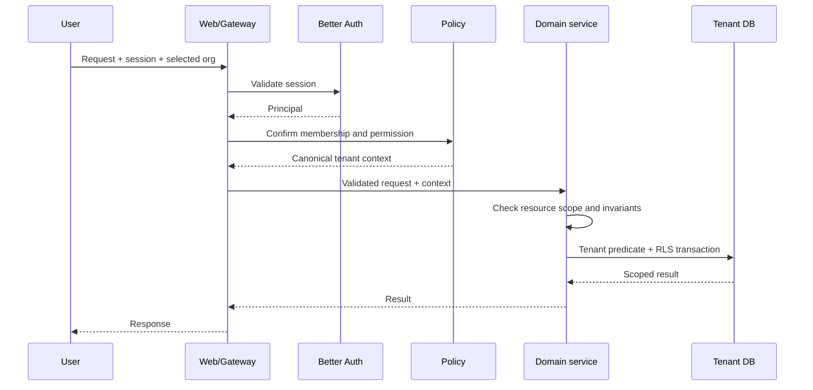
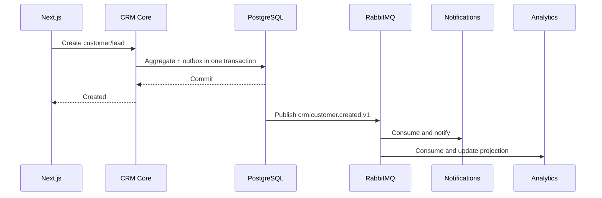
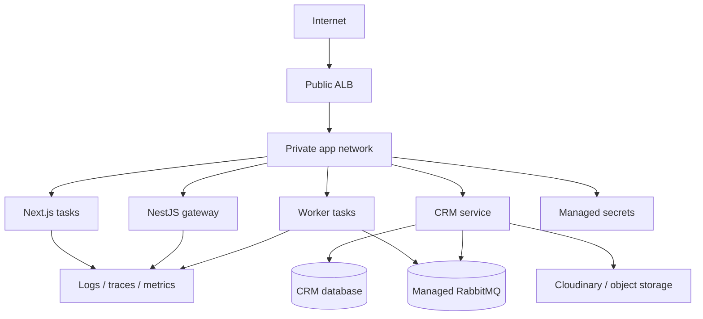

# Architecture Diagrams

These diagrams distinguish source-observed state from a recommended future state.

## Existing

## Proposed services

## Infrastructure role flow

## Authentication/tenant request flow

## Customer creation event flow

## Future AWS deployment

Initially retain the current single app/database and Docker/Compose. K8s and independent services are later choices, not prerequisites.
